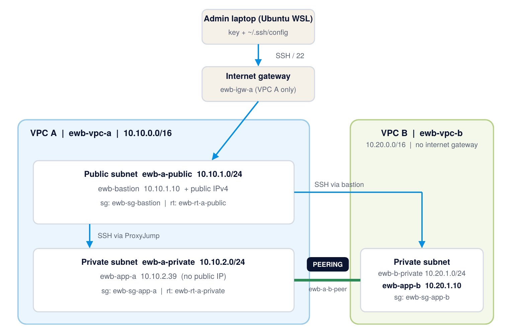

# AWS VPC Peering: private connectivity between two VPCs

EWB Courses, AWS Architect Associate, Project 01. Built and tested in **AWS Asia Pacific (Sydney) / ap-southeast-2** by Harikishore Manday.

Two VPCs are connected with VPC peering so two private servers can talk over private IPs, with one public bastion host for administration. Every claim below is backed by a screenshot in [`screenshots/`](screenshots/) and explained in the [full report](report/Harikishore_EWB_VPC_Peering.pdf).



## What was built

| Resource | Details |
|---|---|
| VPC A (`ewb-vpc-a`) | `10.10.0.0/16`, public subnet `10.10.1.0/24` (bastion), private subnet `10.10.2.0/24` (App-A) |
| VPC B (`ewb-vpc-b`) | `10.20.0.0/16`, private subnet `10.20.1.0/24` (App-B), no internet gateway |
| Internet gateway | `ewb-igw-a`, attached to VPC A only |
| Route tables | `ewb-rt-a-public`, `ewb-rt-a-private`, `ewb-rt-b-private`, each explicitly associated |
| Peering | `ewb-a-b-peer` (same account and Region), routes added on both sides |
| Security groups | `ewb-sg-bastion` (SSH from my IP /32), `ewb-sg-app-a`, `ewb-sg-app-b` (SSH from the bastion, ICMP Echo Request from the other app server) |
| EC2 | 3 x t3.micro, Amazon Linux 2023: `ewb-bastion` (`10.10.1.10`, public IP), `ewb-app-a` (`10.10.2.39`), `ewb-app-b` (`10.20.1.10`) |

All resources were tagged `Project = EWB-VPC-Peering` and `Student = Harikishore`.

## Routes

| Route table | Destination | Target |
|---|---|---|
| `ewb-rt-a-public` | `10.10.0.0/16` / `0.0.0.0/0` / `10.20.0.0/16` | local / internet gateway / peering |
| `ewb-rt-a-private` | `10.10.0.0/16` / `10.20.0.0/16` | local / peering |
| `ewb-rt-b-private` | `10.20.0.0/16` / `10.10.0.0/16` | local / peering (return path) |

## Test results

| Test | Where | Result |
|---|---|---|
| 01 Baseline | App-A, `ping -c 4 10.20.1.10` before peering | 100% packet loss (expected) |
| 02 Forward path | App-A to App-B after routes | 4/4 replies, 0% loss |
| 03 Reverse path | App-B, `ping -c 4 10.10.2.39` | 4/4 replies, 0% loss |
| 04 Private SSH | Laptop, `ssh ewb-app-b` through the bastion (ProxyJump) | Shell on App-B |
| 05 Isolation | EC2 details | No public IPv4 on App-A or App-B |
| Controlled failure | Removed only the Echo Request rule on `ewb-sg-app-b` | 100% loss, then 0% after restoring the rule |

**Key idea:** active peering is not enough. Traffic also needs routes on *both* sides and a security group rule on the destination. The baseline failed because of missing peering and routes; the controlled failure failed because of one missing security group rule.

## Deviations from the workbook

- **Region:** Sydney instead of Mumbai (the lab account is limited to ap-southeast-2).
- **App-A private IP:** AWS assigned `10.10.2.39` instead of `10.10.2.10`, so the ICMP rule on `ewb-sg-app-b` and the SSH config use `10.10.2.39`.

## Repository layout

```
report/        Full project report (PDF and Word)
screenshots/   Numbered evidence for every step, test and cleanup
config/        ssh-config.example (no keys; placeholders only)
```

## Reproduce it

1. Create the VPCs, subnets, internet gateway and route tables with the names and CIDRs above.
2. Create the three security groups and launch the three instances with the fixed private IPs.
3. Copy [`config/ssh-config.example`](config/ssh-config.example) to `~/.ssh/config`, fill in the bastion IP, and keep your own `.pem` key private.
4. Run the baseline ping, create and accept the peering connection, add the three peering routes, then repeat the pings.
5. Remove the Echo Request rule on `ewb-sg-app-b`, ping again (fails), restore it, ping again (works).
6. Delete everything when finished (see the cleanup screenshots).

## Security notes

- The private key (`ewb-lab.pem`) is **not** in this repository, and `.gitignore` blocks `*.pem`.
- Security group rules use single-host `/32` sources; nothing exposes SSH or ICMP to `0.0.0.0/0`.
- All AWS resources were deleted after testing, so nothing from this project is still running.

## Screenshot index

| # | Evidence |
|---|---|
| 1 | [Architecture as built](screenshots/01-architecture-diagram.jpg) |
| 2 | [ewb-rt-a-public associated with ewb-a-public](screenshots/02-checkpoint01-rt-a-public-association.jpg) |
| 3 | [Public route table: 0.0.0.0/0 to the internet gateway (before peering)](screenshots/03-checkpoint01-public-default-route.jpg) |
| 4 | [Private route table: association and only the local route (before peering)](screenshots/04-checkpoint01-rt-a-private-local-only.jpg) |
| 5 | [ewb-rt-b-private associated with ewb-b-private](screenshots/05-rt-b-private-association.jpg) |
| 6 | [ewb-sg-bastion: SSH from my IP /32](screenshots/06-sg-bastion-inbound-rule.jpg) |
| 7 | [ewb-sg-app-a: SSH from bastion, Echo Request from App-B](screenshots/07-sg-app-a-inbound-rules.jpg) |
| 8 | [ewb-sg-app-b: SSH from bastion, Echo Request from App-A](screenshots/08-sg-app-b-inbound-rules.jpg) |
| 9 | [Instance IDs and public IPv4 (bastion only)](screenshots/09-checkpoint02-instances-ids-public-ip.jpg) |
| 10 | [Private IPs of all three instances](screenshots/10-checkpoint02-instances-private-ips.jpg) |
| 11 | [SSH to the bastion from the laptop](screenshots/11-ssh-to-bastion.jpg) |
| 12 | [Peering connection Active, both VPC IDs](screenshots/12-checkpoint03-peering-active.jpg) |
| 13 | [Public route table with the peering route](screenshots/13-checkpoint04-rt-a-public-routes.jpg) |
| 14 | [App-A private route table with the peering route](screenshots/14-checkpoint04-rt-a-private-routes.jpg) |
| 15 | [App-B private route table with the return route](screenshots/15-checkpoint04-rt-b-private-routes.jpg) |
| 16 | [Baseline: ping fails before peering (100% loss)](screenshots/16-test01-baseline-ping-fails.jpg) |
| 17 | [Forward path: App-A to App-B ping (0% loss)](screenshots/17-test02-forward-ping.jpg) |
| 18 | [SSH to App-B via bastion and reverse ping (0% loss)](screenshots/18-test03-04-reverse-ping-and-ssh-app-b.jpg) |
| 19 | [App-A has no public IPv4](screenshots/19-test05-isolation-app-a.jpg) |
| 20 | [App-B has no public IPv4](screenshots/20-test05-isolation-app-b.jpg) |
| 21 | [Echo Request rule removed: 100% loss](screenshots/21-controlled-failure-ping-fails.jpg) |
| 22 | [Rule restored: 0% loss](screenshots/22-controlled-failure-recovery.jpg) |
| 23 | [Cleanup: instances terminated](screenshots/23-cleanup-instances-terminated.jpg) |
| 24 | [Cleanup: no EBS volumes left](screenshots/24-cleanup-volumes-empty.jpg) |
| 25 | [Cleanup: peering connection deleted](screenshots/25-cleanup-peering-deleted.jpg) |
| 26 | [Cleanup: lab security groups deleted](screenshots/26-cleanup-security-groups.jpg) |
| 27 | [Cleanup: lab subnets deleted](screenshots/27-cleanup-subnets.jpg) |
| 28 | [Cleanup: lab route tables deleted](screenshots/28-cleanup-route-tables.jpg) |
| 29 | [Cleanup: lab VPCs deleted (default VPC kept)](screenshots/29-cleanup-vpcs.jpg) |
| 30 | [Cleanup: key pair deleted](screenshots/30-cleanup-key-pair.jpg) |
